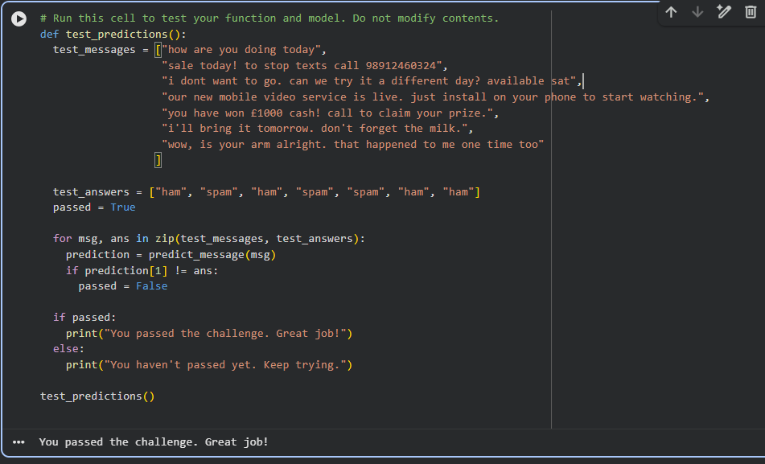

# SMS Text Classification

## Project Overview
A Machine Learning project that classifies SMS messages as **spam** or **ham (not spam)** using Python and Natural Language Processing (NLP).

## Technologies Used
- Python
- Pandas
- Scikit-learn
- Natural Language Processing (NLP)
- Machine Learning

## Project Workflow
1. Load and explore the SMS dataset.
2. Preprocess text messages.
3. Train a classification model.
4. Predict whether a message is spam or ham.
5. Evaluate the model using test messages.

## Project Objective
The goal is to build a model that identifies unwanted spam messages and distinguishes them from legitimate messages.

## Results
Successfully completed the freeCodeCamp SMS Text Classification challenge.

## How to Run
Open `sms_text_classification.ipynb` in Google Colab or Jupyter Notebook and run the cells in order.

## Project Category
Machine Learning · Natural Language Processing · Text Classification
